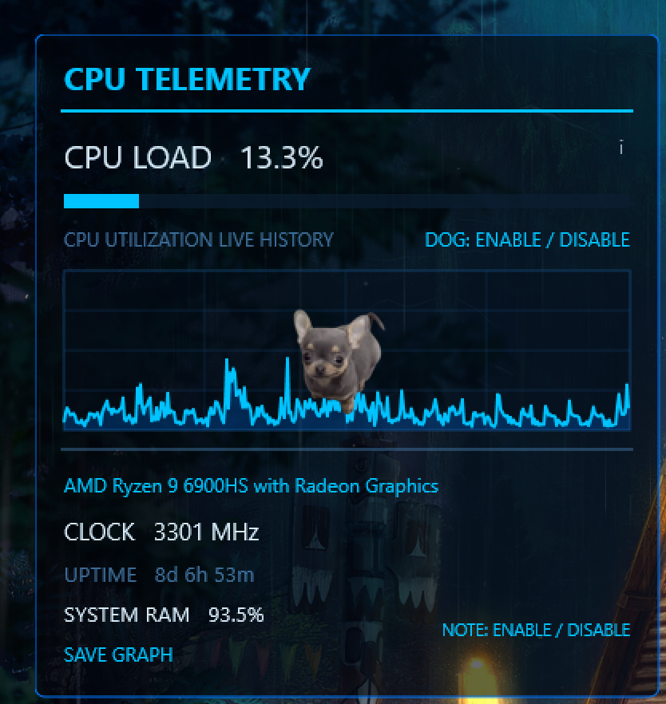
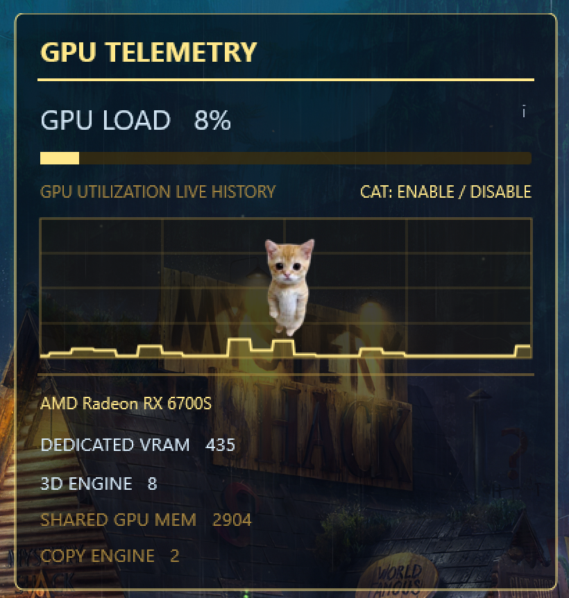
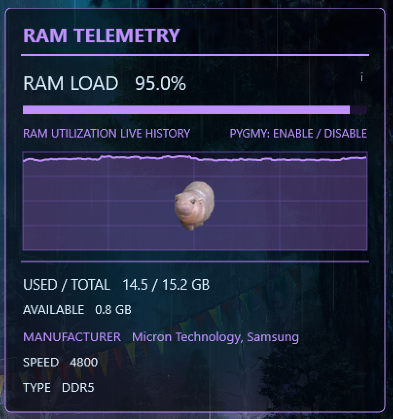
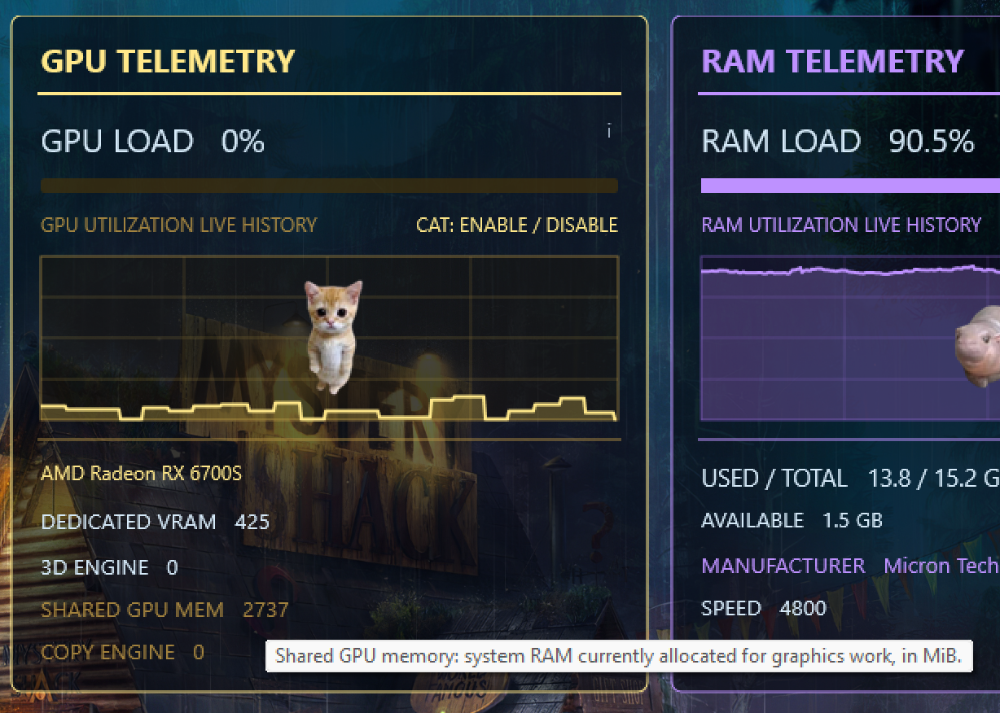

# TRON Telemetry

A portable Windows desktop telemetry dashboard built using **Rainmeter `.ini` configurations** and **PowerShell `.ps1` scripts**.

Originally developed as a client-focused project, TRON Telemetry combines real-time system monitoring with personalized desktop customization. It includes live CPU, GPU, and RAM panels, performance history graphs, explanatory hover tooltips, and optional character overlays.


## Download

**[Download TRON Telemetry Portable v7](TRON_Telemetry_Portable_v7.zip)**

Requires Windows and [Rainmeter](https://www.rainmeter.net/).

---

## Dashboard Features

TRON Telemetry consists of three monitoring panels, each with its own color scheme, performance metrics, and optional visual customization.

### CPU Telemetry



The CPU panel displays:

- Real-time CPU utilization and live history graph
- Processor model and clock speed
- System uptime
- System RAM utilization
- Optional dog overlay
- Optional personalized note
- Save Graph control

**Interactive controls:** Use `DOG: ENABLE / DISABLE` to toggle the dog overlay and `NOTE: ENABLE / DISABLE` to show or hide the personalized note.

### GPU Telemetry



The GPU panel displays:

- Real-time GPU utilization and live history graph
- Graphics adapter information
- Dedicated and shared GPU memory usage
- 3D engine activity
- Copy engine activity
- Optional cat overlay

**Interactive controls:** Use `CAT: ENABLE / DISABLE` to toggle the cat overlay. Hover over supported technical metrics to view explanatory tooltips.

### RAM Telemetry



The RAM panel displays:

- Real-time memory utilization and live history graph
- Used, total, and available system memory
- Memory module manufacturers
- RAM speed and DDR type
- Optional pygmy hippo overlay

**Interactive controls:** Use `PYGMY: ENABLE / DISABLE` to toggle the pygmy hippo overlay.

---

## Interactive Hover Tooltips

TRON Telemetry includes contextual hover tooltips that explain supported technical measurements directly within the dashboard.

For example, hovering over **Shared GPU Memory** displays an explanation of how system RAM can be allocated for graphics workloads.



These tooltips help users interpret performance metrics without needing to research each measurement separately.

**Note:** Hover tooltips are interactive in the installed Rainmeter dashboard. The screenshots above are static previews.

---

## Personalization and Enable/Disable Controls

The dashboard combines system monitoring with client-requested visual customization.

| Panel | Optional Feature | Control |
| --- | --- | --- |
| CPU | Dog overlay | DOG: ENABLE / DISABLE |
| CPU | Personalized note | NOTE: ENABLE / DISABLE |
| GPU | Cat overlay | CAT: ENABLE / DISABLE |
| RAM | Pygmy hippo overlay | PYGMY: ENABLE / DISABLE |

The character overlays are decorative and can be hidden without disabling telemetry monitoring.

Additional interface features include translucent backgrounds, color-coded panels, live utilization graphs, and customizable Rainmeter configurations.

---

## What It Monitors

| CPU | GPU | RAM |
| --- | --- | --- |
| CPU load and history | GPU load and history | RAM load and history |
| CPU model and clock | GPU adapter name | Used, total, and available RAM |
| Uptime | Dedicated GPU memory usage | Memory module manufacturers |
| System RAM load | Shared GPU memory usage | RAM speed and DDR type |
| | 3D engine activity | |
| | Copy engine activity | |

---

## How It Works

- **Rainmeter (`.ini`)** defines panel layouts, meters, charts, positioning, click-to-toggle controls, and hover tooltips.
- **PowerShell (`.ps1`)** collects GPU data from Windows performance counters, graphics adapter information, and RAM hardware specifications using Windows CIM/WMI.
- **`@Resources`** bundles supporting images and scripts in a relative directory for portable installation.

The GPU counters are Windows-native and do **not** reliably expose temperature, core clock, or board power.

Some counters may not exist on particular graphics drivers, and readings may reflect multiple GPU adapters. A missing counter should not be interpreted as a measured zero.

---

## Installation

1. Install [Rainmeter](https://www.rainmeter.net/) on Windows.
2. Download [`TRON_Telemetry_Portable_v7.zip`](TRON_Telemetry_Portable_v7.zip).
3. Extract the **inner** `TRON_Telemetry_Portable_v7` folder into:

   `Documents\Rainmeter\Skins\`

4. Keep `@Resources` alongside `TRON_Telemetry_Portable_v7.ini`.
5. Open Rainmeter Manage, refresh skins, and load `TRON_Telemetry_Portable_v7.ini`.

Windows PowerShell 5.1 and GPU driver support for Windows graphics performance counters are required for the relevant script readings.

Security policies may prevent scripts from running. No separate GPU sensor application is needed.

---

## Versioning and Portability

**Current packaged milestone: v7**

TRON Telemetry v7 includes:

- CPU, GPU, and RAM monitoring panels
- Live performance history graphs
- Hardware information displays
- Interactive hover explanations
- Optional character overlays
- Personalized note controls
- Portable Rainmeter and PowerShell resources

The dashboard was developed and observed on one Windows test machine. Cross-device compatibility remains a goal rather than a verified guarantee.

---

## Repository Contents

```text
TRON-Telemetry/
├── README.md
├── images/
│   ├── version7.png
│   ├── CPU-preview.png
│   ├── GPU-preview.png
│   ├── RAM-preview.png
│   └── GPUinfo.png
└── TRON_Telemetry_Portable_v7.zip
```

The ZIP archive contains the Rainmeter skin, PowerShell scripts, and supporting image assets.

---

## Project Links

**GitHub Repository:**  
https://github.com/track001/TRON-Telemetry

**Technical Portfolio:**  
https://track001.github.io/tiana-schwarz-portfolio/

**Rainmeter:**  
https://www.rainmeter.net/

---

## License

This repository does not currently include an explicit software license.

Project files are publicly accessible for viewing and downloading. Permission to modify or redistribute the software is not automatically granted without an applicable license.
