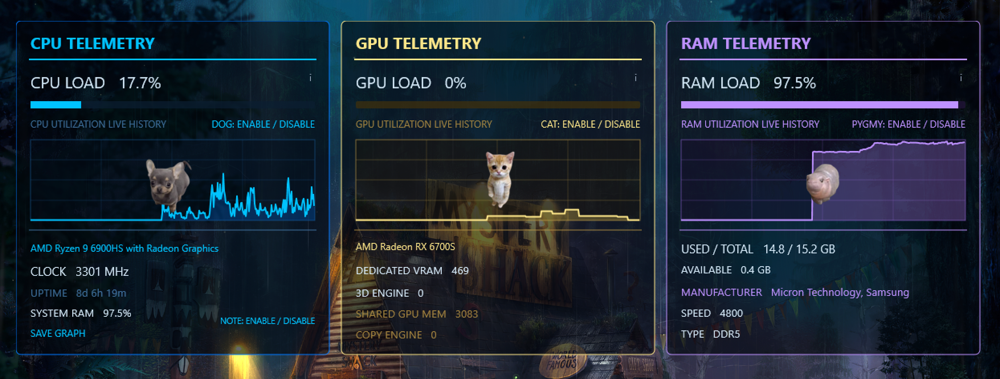

# TRON Telemetry

A portable Windows desktop telemetry dashboard built using **Rainmeter `.ini` configuration** and **PowerShell `.ps1` scripts**. The project includes live CPU, GPU, and RAM panels, history graphs, explanatory hover tooltips, and optional character overlays.

**Live site (after enabling GitHub Pages):** https://track001.github.io/TRON-Telemetry/  
**Download:** [TRON Telemetry Portable v7](TRON_Telemetry_Portable_v7.zip)

## What it monitors

| CPU | GPU | RAM |
| --- | --- | --- |
| CPU load and history | GPU load and history | RAM load and history |
| CPU model and clock | GPU adapter name | Used / total and available RAM |
| Uptime | Dedicated GPU memory usage | Module manufacturers |
| System RAM load | 3D engine and copy engine | RAM speed and DDR type |
| Dog and note toggles | Shared GPU memory, cat toggle | Pygmy toggle |

## How it works

- **Rainmeter (`.ini`)** describes meters, charts, positioning, click-to-toggle controls, and hover tooltips.
- **PowerShell (`.ps1`)** collects GPU data from Windows performance counters and GPU adapter information, and RAM hardware information via Windows CIM/WMI.
- **`@Resources`** bundles images and scripts in a relative directory for portable installation.

The GPU counters are Windows-native and do **not** reliably expose temperature, core clock, or board power. Some counters may not exist on a particular driver, and readings can reflect multiple GPU adapters. A missing counter should not be interpreted as a measured zero.

## Install

1. Install [Rainmeter](https://www.rainmeter.net/) on Windows.
2. Download [`TRON_Telemetry_Portable_v7.zip`](TRON_Telemetry_Portable_v7.zip).
3. Extract the **inner** `TRON_Telemetry_Portable_v7` folder into `Documents\Rainmeter\Skins\`.
4. Keep `@Resources` alongside `TRON_Telemetry_Portable_v7.ini`.
5. In Rainmeter Manage, refresh skins and load `TRON_Telemetry_Portable_v7.ini`.

Windows PowerShell 5.1 and GPU driver support for Windows graphics performance counters are needed for the relevant script readings. Security policies may prevent scripts from running. No separate GPU sensor application is needed.

## Versioning and portability

This repository preserves **v7** as the current packaged milestone. It was developed and observed on one Windows test machine; cross-device compatibility is a goal, not a verified guarantee. Do not assume every graphics adapter exposes identical counters.

## Repository contents

- `index.html` — GitHub Pages showcase.
- `assets/tron-telemetry-v7.png` — dashboard screenshot.
- `TRON_Telemetry_Portable_v7.zip` — Rainmeter skin, PowerShell scripts, and image assets.

## Publish with GitHub Pages

1. Create a **public** repository named `TRON-Telemetry` under `track001`.
2. Upload all files from this repository starter ZIP, keeping `index.html` at the repository root.
3. In **Settings → Pages**, choose **Deploy from a branch**, branch `main`, folder `/ (root)`, and save.
4. Visit https://track001.github.io/TRON-Telemetry/ after deployment completes.

This project does not include an explicit software license. Add one before inviting reuse or redistribution beyond normal GitHub viewing/downloading.
